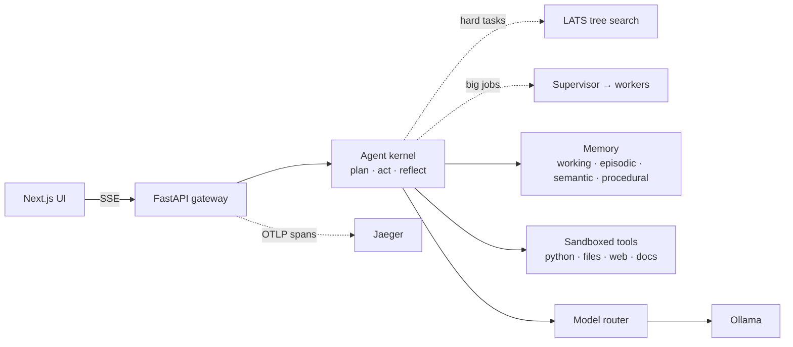

<!--
  Profile README for github.com/roydonsequeira
  · Artwork in assets/ is generated by scripts/build_assets.py: edit the text there and re-run it.
  · The "Recently shipped" table is refreshed daily by .github/workflows/readme-sync.yml.
-->

<a href="https://roydonsequeira.com">
  <picture>
    <source media="(prefers-color-scheme: dark)" srcset="assets/hero-dark.svg">
    <source media="(prefers-color-scheme: light)" srcset="assets/hero-light.svg">
    
  </picture>
</a>

<p align="center">
  <a href="https://roydonsequeira.com"></a>
  <a href="https://www.linkedin.com/in/roydonsequeira/"></a>
  <a href="https://x.com/roydonsequeiraa"></a>
  <a href="mailto:roydnsequeira@gmail.com"></a>
</p>

I build AI agents at Code Crew Studio, currently a WhatsApp onboarding agent on FastAPI and PostgreSQL. Before that I led a patient-intake agent at ReinHealth, a healthcare AI startup. It ran on local models, so no patient records went to outside APIs.

My open-source project is CORTEX, an agent that runs entirely on your own machine. Running it through 187 live conversations with a 7B model turned up 27 bugs its unit tests had missed. I wrote about what they taught me in [187 live prompts, 27 bugs](https://dev.to/roydonsequeira/187-live-prompts-27-bugs-what-testing-my-local-ai-agent-against-a-real-7b-model-taught-me-3h6).

<picture>
  <source media="(prefers-color-scheme: dark)" srcset="assets/impact-dark.svg">
  <source media="(prefers-color-scheme: light)" srcset="assets/impact-light.svg">
  
</picture>

<sub>Intake figures are estimates from the production agent I led at ReinHealth. The bug count comes from CORTEX's <a href="https://github.com/roydonsequeira/CORTEX-Private-Intelligence-Framework/tree/main/evals/live_battery">live test battery</a>.</sub>

## Open source

Most of these run entirely on your own hardware, with no API keys.

<a href="https://github.com/roydonsequeira/CORTEX-Private-Intelligence-Framework">
  <picture>
    <source media="(prefers-color-scheme: dark)" srcset="assets/cortex-dark.svg">
    <source media="(prefers-color-scheme: light)" srcset="assets/cortex-light.svg">
    
  </picture>
</a>

<p align="center">
  <a href="https://github.com/roydonsequeira/CORTEX-Private-Intelligence-Framework/actions/workflows/ci.yml"></a>
  <a href="https://github.com/roydonsequeira/CORTEX-Private-Intelligence-Framework/commits/main"></a>
  
</p>

**Why it holds up on a 7B model.** Small models don't reliably follow rules that exist only in the prompt. In live testing with `qwen2.5:7b`, the model claimed it had saved a file without calling the tool, and followed an instruction hidden in text it was asked to summarize. So CORTEX enforces the rules in code:

- Plans that need no tools run with no tool schemas at all, and destructive plans become refusals before anything executes.
- Pasted or quoted text is treated as data, so instructions hidden inside it can't trigger a tool.
- Web fetch reaches public hosts only. Loopback, private-network and cloud-metadata addresses are refused after DNS resolution and on every redirect.
- Memory stores only durable facts you state about yourself.

<details>
<summary><b>Architecture and quick start</b></summary>
<br>



```bash
git clone https://github.com/roydonsequeira/CORTEX-Private-Intelligence-Framework.git && cd CORTEX-Private-Intelligence-Framework
ollama pull qwen2.5:7b && ollama pull nomic-embed-text
pip install -e . && cortex doctor && cortex serve    # API on :8000
cd ui && npm install && npm run dev                   # UI on :3000
```

</details>

<p align="center">
  <a href="https://github.com/roydonsequeira/RagChatbot"><picture><source media="(prefers-color-scheme: dark)" srcset="assets/ragchatbot-dark.svg"><source media="(prefers-color-scheme: light)" srcset="assets/ragchatbot-light.svg"></picture></a>
  <a href="https://github.com/roydonsequeira/clinicalNote-SOAP"><picture><source media="(prefers-color-scheme: dark)" srcset="assets/soap-dark.svg"><source media="(prefers-color-scheme: light)" srcset="assets/soap-light.svg"></picture></a>
  <a href="https://github.com/roydonsequeira/Skin-Lesion-Segmentation-in-TensorFlow-2.0"><picture><source media="(prefers-color-scheme: dark)" srcset="assets/lesion-dark.svg"><source media="(prefers-color-scheme: light)" srcset="assets/lesion-light.svg"></picture></a>
  <a href="https://roydonsequeira.com"><picture><source media="(prefers-color-scheme: dark)" srcset="assets/lab-dark.svg"><source media="(prefers-color-scheme: light)" srcset="assets/lab-light.svg"></picture></a>
</p>

### Recently shipped

<!-- recent-repos:start -->
| Project | What it is | Last push |
| --- | --- | --- |
| [**CORTEX-Private-Intelligence-Framework**](https://github.com/roydonsequeira/CORTEX-Private-Intelligence-Framework)<br><sub>Python · ★ 6</sub> | Private, local-first AI agent: planning, sandboxed tools, four-tier memory, streaming UI and OpenTelemetry — runs entirely on your machine with Ollama. | <code>2026-11-08</code> |
| [**Skin-Lesion-Segmentation-in-TensorFlow-2.0**](https://github.com/roydonsequeira/Skin-Lesion-Segmentation-in-TensorFlow-2.0)<br><sub>Python</sub> | Skin lesion segmentation on ISIC 2018 using U-Net (PyTorch) and ResU-Net (TensorFlow 2). Final year project. | <code>2026-10-18</code> |
| [**RagChatbot**](https://github.com/roydonsequeira/RagChatbot)<br><sub>Python</sub> | Local RAG chatbot: Ollama LLM, ChromaDB vector store, OCR/PDF ingestion, Next.js UI | <code>2026-04-09</code> |
| [**clinicalNote-SOAP**](https://github.com/roydonsequeira/clinicalNote-SOAP) | n8n workflows that turn clinical text or voice into structured SOAP notes with a local LLM | <code>2026-03-25</code> |
<!-- recent-repos:end -->

<sub>Refreshed daily from the GitHub API by <a href=".github/workflows/readme-sync.yml">readme-sync</a>.</sub>

## Experience

- **AI Agent Developer, Code Crew Studio** · Feb 2026 – present · remote<br>
  Production onboarding agent on the WhatsApp Business API, with FastAPI and PostgreSQL for agent state and conversation history.
- **GenAI Engineer, ReinHealth** (stealth healthcare AI startup) · Jul 2024 – Feb 2026 · remote, US<br>
  Led a medical intake agent over text and voice on local Ollama models, with RAG on Qdrant and PostgreSQL, and n8n automations for clinical notes and scheduling.
- **Machine Learning Intern, Igeeks Technologies** · Jun – Jul 2023 · Bengaluru<br>
  CNN, AlexNet and MLP image classifiers with OpenCV preprocessing.

**Education:** B.E. in Artificial Intelligence & Machine Learning, NMAM Institute of Technology (2020–2024) · Executive PG Certification in Data Science & AI, iHUB DivyaSampark, IIT Roorkee (2024–2026)

## Stack

| Layer | Tools |
| --- | --- |
| **Agents & LLMs** | LangChain · ReAct · Ollama · Claude · Gemini · OpenAI · Hugging Face · STT/TTS |
| **Retrieval** | Qdrant · ChromaDB · BGE and nomic embeddings · semantic search · PostgreSQL · Redis |
| **Backend** | Python · FastAPI · Flask · Pydantic · SQL · REST · SSE streaming |
| **Automation** | n8n · WhatsApp Business API · Twilio |
| **ML & vision** | PyTorch · TensorFlow · scikit-learn · OpenCV · NumPy · Pandas |
| **Ship & observe** | Docker · Linux · GitHub Actions · OpenTelemetry · Vercel · ruff · mypy |
| **Agent UIs** | Next.js · TypeScript · Tailwind CSS |

Open to AI engineering roles and contract work: [roydnsequeira@gmail.com](mailto:roydnsequeira@gmail.com)
